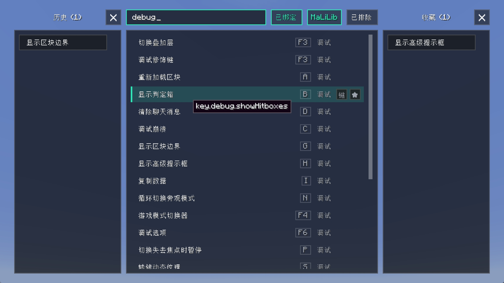

# Shortcuts Panel

English | [简体中文](README.md)

A keybind panel you can search and trigger, covering every keybind registered by mods. Supports
filtering unbound keys, binding on the spot, favourites, history and excluding results.
Understands the masa family of keybinds (tweakeroo, minihud, litematica, itemscroller, …).

- Press **K** to open it by default.

- Right-click a search result to exclude it.

- Right-click a favourite to remove it; drag to reorder.

Search matches the **binding name** (weight 3), the **internal key name** `key.xxx` (weight 2) and
the **category name** (weight 1). Scoring is exact > prefix > substring > subsequence, and both
localised names and English key names are searchable.
